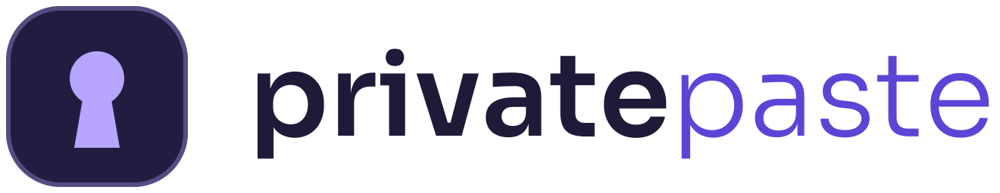
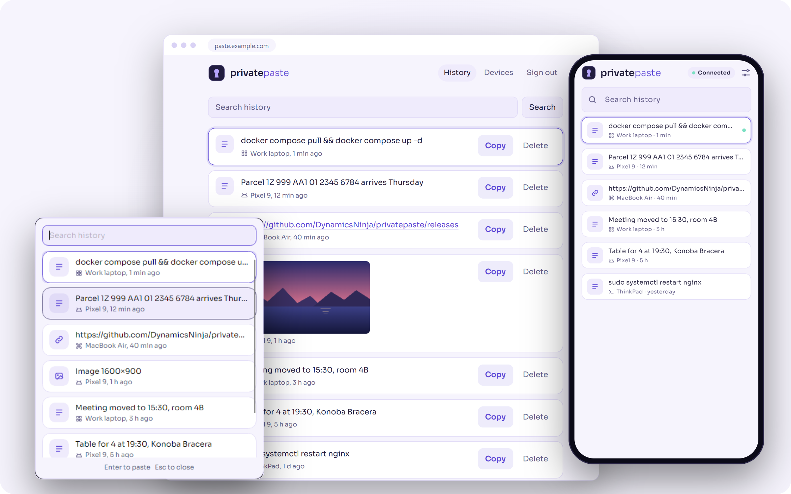
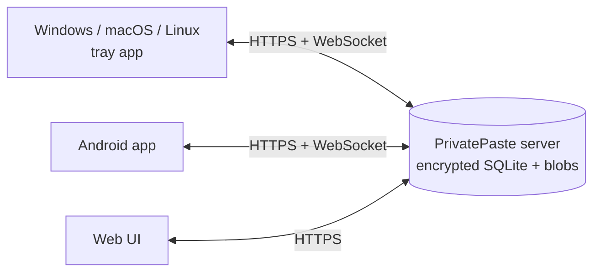

<p align="center">
  <picture>
    <source media="(prefers-color-scheme: dark)" srcset="branding/lockup-on-dark.svg">
    
  </picture>
</p>

<h3 align="center">Your clipboard on every device, kept on your own server.</h3>

<p align="center">
  Copy on your laptop, paste on your phone. PrivatePaste is a self-hosted clipboard sync with an encrypted, searchable history, for Windows, macOS, Linux, Android and the web.
</p>

<p align="center">
  <a href="#quick-start">Quick start</a> ·
  <a href="https://github.com/DynamicsNinja/privatepaste/releases">Download</a> ·
  <a href="docs/self-hosting.md">Self-hosting</a> ·
  <a href="docs/api.md">API</a>
</p>

<p align="center">
  <a href="https://github.com/DynamicsNinja/privatepaste/releases?q=desktop-v&expanded=true"></a>
  <a href="https://github.com/DynamicsNinja/privatepaste/releases?q=android-v&expanded=true"></a>
  
  
</p>

<picture>
  <source media="(prefers-color-scheme: dark)" srcset="docs/images/hero-dark.png">
  
</picture>

## Why PrivatePaste

- **Copy here, paste there.** Text, links and images you copy show up on the clipboard of your other devices a moment later.
- **A history you can search.** Every clip is kept until you delete it, with the device it came from, so the thing you copied last Tuesday is still one search away.
- **Only on your server.** One small container. No accounts, no cloud relay, no push service, no analytics, no third-party requests.
- **Encrypted at rest.** The database (SQLite3 Multiple Ciphers) and the stored images are encrypted with a key that only you hold.
- **Native on every device.** A tray app with a history popup (Ctrl+Shift+V) on Windows, macOS and Linux, an Android app with a Quick Settings tile and a Share target, and a web UI for everything else.
- **Knows where a clip came from.** Each clip carries its device's name and platform icon, and the desktop app can show a small notification when a clip from another device lands.

## Apps

| Platform | Get it | Notes |
|---|---|---|
| Windows | `.msi` installer or portable `.zip` from [Releases](https://github.com/DynamicsNinja/privatepaste/releases) | Installs for your user only, no admin prompt. [Details](docs/desktop.md) |
| macOS | `osx-arm64` / `osx-x64` `.zip` | Apple Silicon and Intel. Not notarized yet. [Details](docs/desktop.md#macos-and-linux) |
| Linux | `linux-x64.tar.gz` | Best on X11. [Details](docs/desktop.md#macos-and-linux) |
| Android | `.apk` | Android 10 or newer, sideloaded. [Details](docs/android.md) |
| Web | Built into the server | Any modern browser. |

## Quick start

### Dokploy

1. Create a **Compose** service from this repository.
2. Set `PP_DB_KEY` (a random key, see below) and `PP_PASSWORD` (your login password).
3. Add a domain for service `privatepaste` on port `8080` with HTTPS.
4. Deploy, then sign in from the apps with your domain and password.

### Docker Compose

```bash
git clone https://github.com/DynamicsNinja/privatepaste.git
cd privatepaste
cat > .env <<EOF
PP_DB_KEY=$(openssl rand -base64 32)
PP_PASSWORD=choose-a-strong-password
EOF
docker compose up -d
```

Put it behind a reverse proxy with HTTPS (Traefik, Caddy, nginx) that forwards to the container's port `8080`. The port is deliberately not published, because the login rate limit trusts the proxy's forwarded client IP.

To skip the build, use the prebuilt image `ghcr.io/dynamicsninja/privatepaste` (linux/amd64 and linux/arm64): [`deploy/dokploy/privatepaste/docker-compose.yml`](deploy/dokploy/privatepaste/docker-compose.yml) is a ready compose file for it.

> [!IMPORTANT]
> Keep `PP_DB_KEY` somewhere safe, apart from your backups. Everything is encrypted with it: without the key the data can't be recovered.

All settings, backups and proxy notes are in [Self-hosting](docs/self-hosting.md).

### Connect your devices

Install an app, then enter your server URL, the password and a name for the device. That's it: from then on the device stays signed in and in sync. You can see and revoke devices on the **Devices** page of the web UI.

## How it works



Each device signs in with the server password once and gets its own device token. A copy is uploaded to the server, stored, and pushed over a WebSocket to your other devices, which put it on their clipboard. A device that was offline catches up when it reconnects, and only the newest clip lands on its clipboard, so nothing old overwrites what you have now. The same content copied twice is bumped to the top instead of stored again.

## Security

- The database and image files are encrypted at rest with `PP_DB_KEY`.
- The password is hashed with Argon2id. Sign-in is rate-limited per client IP.
- Every device has its own token. Revoke a lost device from the web UI and it is signed out at once.
- Only HTTPS servers are accepted by the apps (plain HTTP only for localhost).
- The server can read your clips: this is encryption at rest, not end-to-end encryption. Run it on a machine you trust.

## Documentation

| Guide | What's in it |
|---|---|
| [Self-hosting](docs/self-hosting.md) | Environment variables, keys, changing the password, backups, proxies, local development |
| [Desktop app](docs/desktop.md) | Install, upgrade, hotkey, pause, uninstall, building from source; macOS and Linux notes |
| [Android app](docs/android.md) | Install, background delivery, battery settings by phone maker, building and releasing |
| [API reference](docs/api.md) | Endpoints, WebSocket messages, client rules and the content hash, for writing your own client |
| [Branding](branding/README.md) | Logo, colors and type |

## Built with

[ASP.NET Core](https://dotnet.microsoft.com/apps/aspnet) on .NET 10 and [SQLite3 Multiple Ciphers](https://utelle.github.io/SQLite3MultipleCiphers/) on the server, [Avalonia](https://avaloniaui.net/) for the desktop app, Kotlin and Jetpack Compose for Android, and the [Sora](https://fonts.google.com/specimen/Sora) typeface.
