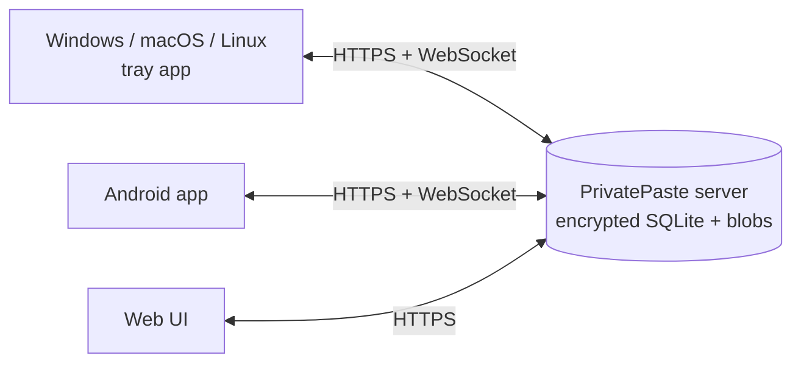

<p align="center">
  <picture>
    <source media="(prefers-color-scheme: dark)" srcset="branding/lockup-on-dark.svg">
    
  </picture>
</p>

<h3 align="center">Your clipboard on every device, kept on your own server.</h3>

<p align="center">
  Copy on your laptop, paste on your phone. PrivatePaste is a self-hosted clipboard sync with an encrypted, searchable history, for Windows, macOS, Linux, Android and the web.
</p>

<p align="center">
  <a href="#quick-start">Quick start</a> ·
  <a href="https://github.com/DynamicsNinja/privatepaste/releases">Download</a> ·
  <a href="docs/self-hosting.md">Self-hosting</a> ·
  <a href="docs/api.md">API</a>
</p>

<p align="center">
  <a href="https://github.com/DynamicsNinja/privatepaste/releases?q=desktop-v&expanded=true"></a>
  <a href="https://github.com/DynamicsNinja/privatepaste/releases?q=android-v&expanded=true"></a>
  
  <a href="LICENSE"></a>
  
</p>

<picture>
  <source media="(prefers-color-scheme: dark)" srcset="docs/images/hero-dark.png">
  
</picture>

## Why PrivatePaste

- **Copy here, paste there.** Text, links and images you copy show up on the clipboard of your other devices a moment later.
- **A history you can search.** Every clip is kept until you delete it (or clear the history), with the device it came from, so the thing you copied last Tuesday is still one search away.
- **Private copies stay private.** On the desktop apps, a copy that a password manager marks as private never leaves your computer: it isn't uploaded, cached or shown anywhere. The desktop app can also ignore copies from apps you name. Android only sends what you send or share yourself. [Details](docs/desktop.md#private-copies)
- **Pinned clips.** Pin the clips you reuse. They get their own tab on every device and survive clearing and auto-delete.
- **Clear it when you want.** Clear the history from the web UI, or let the server delete clips older than 7, 30 or 90 days. Pinned clips stay. Off by default: otherwise clips are kept until you delete them.
- **Multiple people, one shared history.** Add the people you share a server with (a household, a small team). Each signs in with their own name and password, everyone sees the same history, and each clip shows who copied it. The owner can sign someone out or remove them without changing a password for everyone. [Details](docs/self-hosting.md#people)
- **Only on your server.** One small container. No cloud relay, no push service, no analytics, no third-party requests.
- **Encrypted at rest.** The database (SQLite3 Multiple Ciphers) and the stored images are encrypted with a key that only you hold.
- **Native on every device.** A tray app with a history popup (Ctrl+Shift+V) on Windows, macOS and Linux, an Android app with a Quick Settings tile and a Share target, and a web UI for everything else.
- **Knows where a clip came from.** Each clip carries its device's name and platform icon (and, once a second person is added, a chip with the name of who copied it), and the desktop app can show a small notification when a clip from another device lands.

## Apps

| Platform | Get it | Notes |
|---|---|---|
| Windows | `.msi` installer or portable `.zip` from [Releases](https://github.com/DynamicsNinja/privatepaste/releases) | Installs for your user only, no admin prompt. [Details](docs/desktop.md) |
| macOS | `osx-arm64` / `osx-x64` `.zip` | Apple Silicon and Intel. Not notarized yet. [Details](docs/desktop.md#macos-and-linux) |
| Linux | `linux-x64.tar.gz` | Best on X11. [Details](docs/desktop.md#macos-and-linux) |
| Android | `.apk` | Android 10 or newer, sideloaded. [Details](docs/android.md) |
| Web | Built into the server | Any modern browser. |

## Quick start

### Dokploy

1. Create a **Compose** service from this repository.
2. Set `PP_DB_KEY` (a random key, see below) and `PP_PASSWORD` (the owner's password).
3. Add a domain for service `privatepaste` on port `8080` with HTTPS.
4. Deploy, then sign in from the apps with your domain, the name `owner` and that password.

### Docker Compose

```bash
git clone https://github.com/DynamicsNinja/privatepaste.git
cd privatepaste
cat > .env <<EOF
PP_DB_KEY=$(openssl rand -base64 32)
PP_PASSWORD=choose-a-strong-password
EOF
docker compose up -d
```

Put it behind a reverse proxy with HTTPS (Traefik, Caddy, nginx) that forwards to the container's port `8080`. The port is deliberately not published, because the login rate limit trusts the proxy's forwarded client IP.

To skip the build, use the prebuilt image `ghcr.io/dynamicsninja/privatepaste` (linux/amd64 and linux/arm64): [`deploy/dokploy/privatepaste/docker-compose.yml`](deploy/dokploy/privatepaste/docker-compose.yml) is a ready compose file for it.

> [!IMPORTANT]
> Keep `PP_DB_KEY` somewhere safe, apart from your backups. Everything is encrypted with it: without the key the data can't be recovered.

All settings, backups and proxy notes are in [Self-hosting](docs/self-hosting.md).

### Connect your devices

Install an app, then enter your server URL, your name and password, and a name for the device. On a new server the name is `owner` and the password is `PP_PASSWORD`. That's it: from then on the device stays signed in and in sync. Add the other people on the **People** page of the web UI, where you can also see and sign out devices.

> [!NOTE]
> **Upgrading a server that several people already share?** First, right after upgrading, change the owner's password (**Settings > Change password**, or set a new `PP_PASSWORD` and restart): anyone who knew the old shared password may be signed in on the web as `owner`, and this ends those sessions. Every existing device becomes the owner's and keeps working. Sign the devices that belong to someone else out on the **People** page; each person then signs in again with their own account. Apps from before this version can't sign in until they are updated. Back up `/data` before upgrading. [Details](docs/self-hosting.md#upgrading-to-multiple-people)

## How it works



Each device signs in with a person's name and password once and gets its own device token. A copy is uploaded to the server, stored, and pushed over a WebSocket to your other devices, which put it on their clipboard. A device that was offline catches up when it reconnects, and only the newest clip lands on its clipboard, so nothing old overwrites what you have now. The same content copied twice is bumped to the top instead of stored again.

## Security

- The database and image files are encrypted at rest with `PP_DB_KEY`.
- Passwords are hashed with Argon2id. Sign-in is rate-limited per client IP.
- Every device has its own token. Sign out a lost device from the People page and it is out at once. Removing a person or resetting their password signs out all their devices and web sessions. Changing your own password signs you out of your other browsers and keeps your devices signed in.
- Only the owner can add or remove people, clear the history or change auto-delete.
- Only HTTPS servers are accepted by the apps (plain HTTP only for localhost).
- On the desktop apps, copies that password managers mark as private, and copies from apps on the blocklist, are never uploaded. This depends on the app marking its copies; see [Private copies](docs/desktop.md#private-copies) for what is covered. Android sends only what you send or share yourself.
- The server can read your clips: this is encryption at rest, not end-to-end encryption. Run it on a machine you trust.

## Documentation

| Guide | What's in it |
|---|---|
| [Self-hosting](docs/self-hosting.md) | Environment variables, keys, people and passwords, upgrading, backups, clearing history and auto-delete, proxies, local development |
| [Desktop app](docs/desktop.md) | Install, upgrade, hotkey, pause, pinned clips, private copies and the app blocklist, uninstall, building from source; macOS and Linux notes |
| [Android app](docs/android.md) | Install, pinned clips, background delivery, battery settings by phone maker, building and releasing |
| [API reference](docs/api.md) | Endpoints, WebSocket messages, client rules and the content hash, for writing your own client |
| [Branding](branding/README.md) | Logo, colors and type |

## Code signing policy

Free code signing provided by [SignPath.io](https://about.signpath.io), certificate by [SignPath Foundation](https://signpath.org).

> Applied for; until it is approved, the Windows downloads are unsigned (see [SmartScreen](docs/desktop.md)).

- What is signed: the Windows app (`PrivatePaste.exe`) and its installer (`PrivatePaste-<version>-win-x64.msi`), built from this repository by the [desktop release workflow](.github/workflows/desktop.yml) on GitHub-hosted runners. Nothing built elsewhere is signed.
- Committers and reviewers: [Ivan Ficko](https://github.com/DynamicsNinja). Changes from anyone else come in as pull requests and are reviewed before they are merged.
- Approvers: [Ivan Ficko](https://github.com/DynamicsNinja). Every release is approved by hand before it is signed.
- Privacy: PrivatePaste sends data only to the PrivatePaste server you enter when you sign in, which you or someone you trust runs. It sends nothing to the authors or to any other system.

## Built with

[ASP.NET Core](https://dotnet.microsoft.com/apps/aspnet) on .NET 10 and [SQLite3 Multiple Ciphers](https://utelle.github.io/SQLite3MultipleCiphers/) on the server, [Avalonia](https://avaloniaui.net/) for the desktop app, Kotlin and Jetpack Compose for Android, and the [Sora](https://fonts.google.com/specimen/Sora) typeface.

## License

[MIT](LICENSE). The bundled Sora font is under the [SIL Open Font License](src/PrivatePaste.Server/wwwroot/fonts/OFL.txt).
